# Programa Formar · Certificados

[](https://github.com/Kamadoo/programa-formar/actions/workflows/ci.yml)


Gestão de formações de servidores, lançamento de presença e emissão de certificados com **validação pública**, num só sistema.

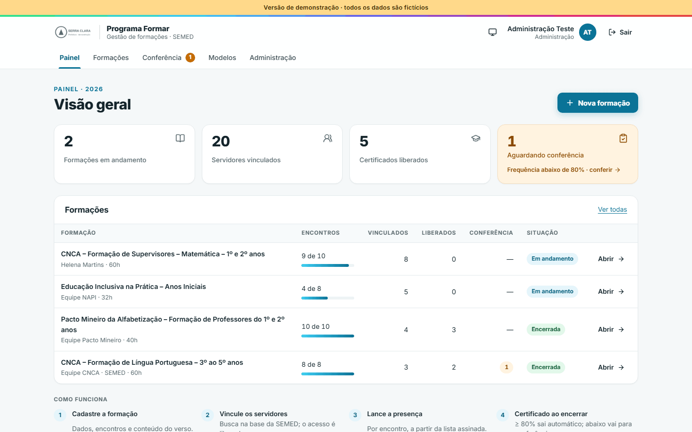

> [!IMPORTANT]
> **Projeto de demonstração.** Este repositório existe apenas para apresentar o sistema. O município "Serra Clara", a marca, o CNPJ, o endereço, as pessoas, os CPFs, as matrículas e os e-mails são **fictícios**. Não é o site oficial de nenhum órgão público e não contém dados reais.

Sistema web para uma secretaria municipal de educação **gerir as formações dos servidores e emitir certificados** com validação pública.

## Telas

### Gestão das formações

Presença lançada por encontro, com frequência calculada na hora e certificado emitido automaticamente ao encerrar.

<table>
  <tr>
    <td width="50%">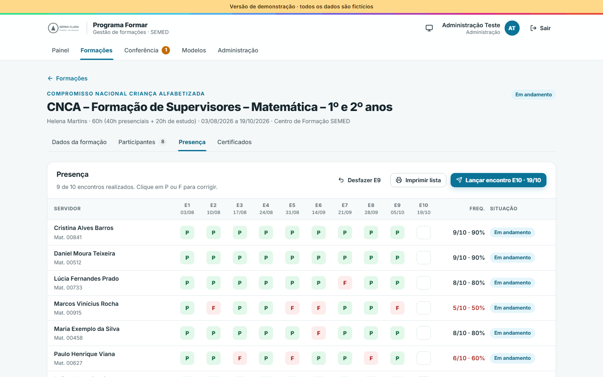<br><sub><b>Presença</b>: P/F por encontro, frequência e situação de cada servidor.</sub></td>
    <td width="50%">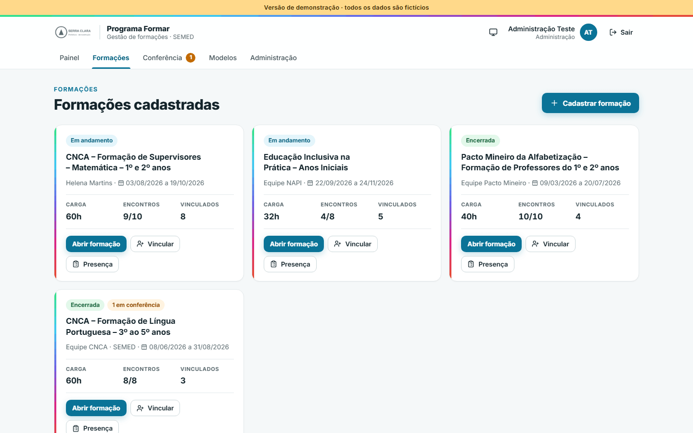<br><sub><b>Formações</b>: andamento, vínculos e certificados de cada turma.</sub></td>
  </tr>
  <tr>
    <td>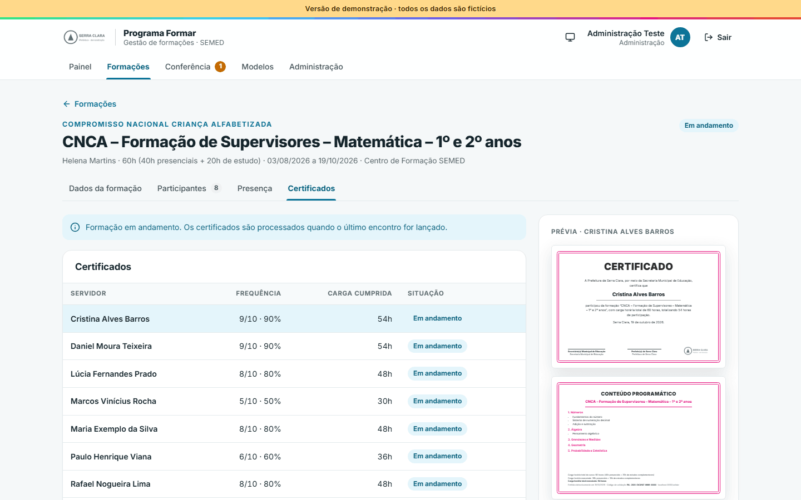<br><sub><b>Certificados</b>: frequência, carga cumprida e prévia do certificado de cada servidor.</sub></td>
    <td>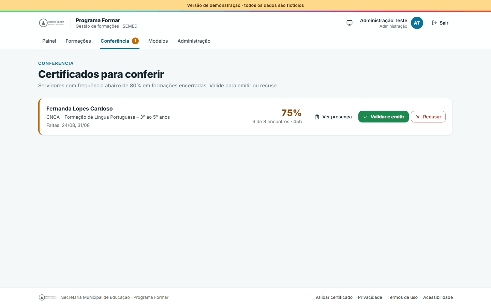<br><sub><b>Conferência</b>: quem ficou abaixo de 80% passa por decisão da gestão.</sub></td>
  </tr>
  <tr>
    <td>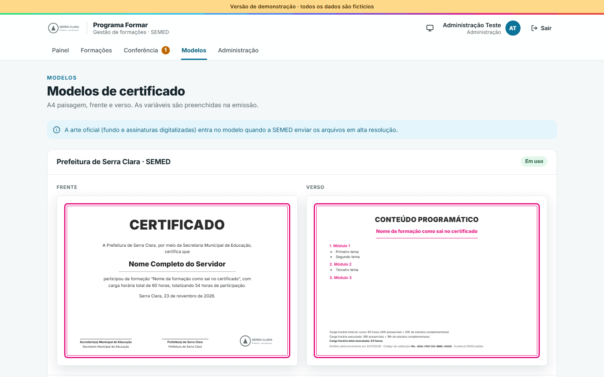<br><sub><b>Modelo</b>: certificado A4, frente e verso com conteúdo programático.</sub></td>
    <td>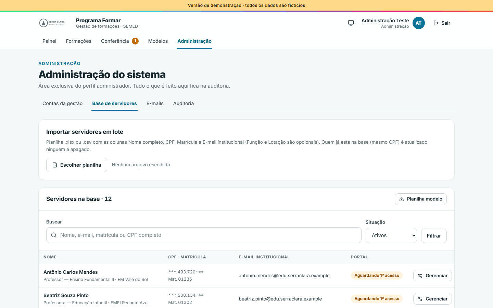<br><sub><b>Administração</b>: base de servidores com importação em lote e edição.</sub></td>
  </tr>
</table>

### Portal do servidor e validação pública

<table>
  <tr>
    <td width="50%">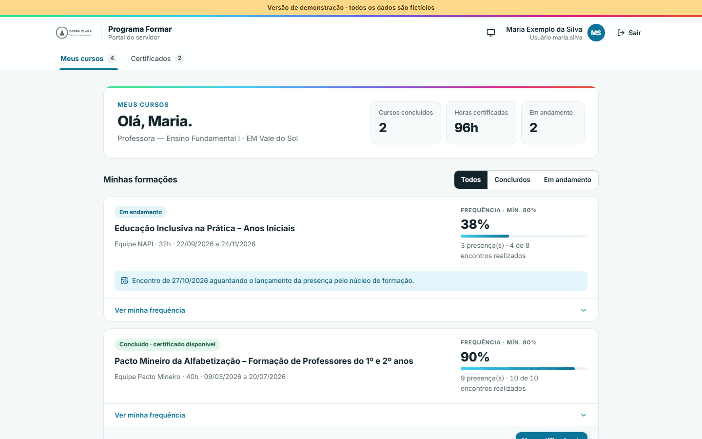<br><sub><b>Meus cursos</b>: frequência de cada formação, só para consulta.</sub></td>
    <td width="50%">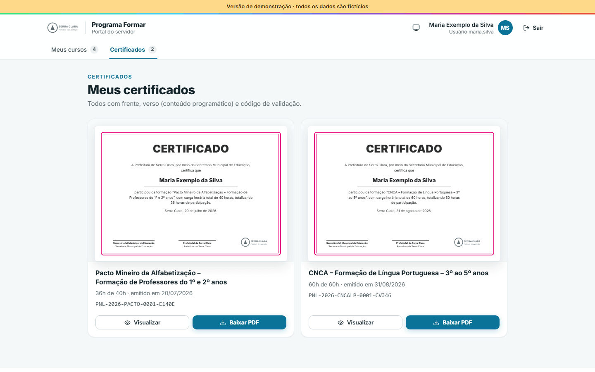<br><sub><b>Certificados</b>: download em PDF, frente e verso.</sub></td>
  </tr>
  <tr>
    <td>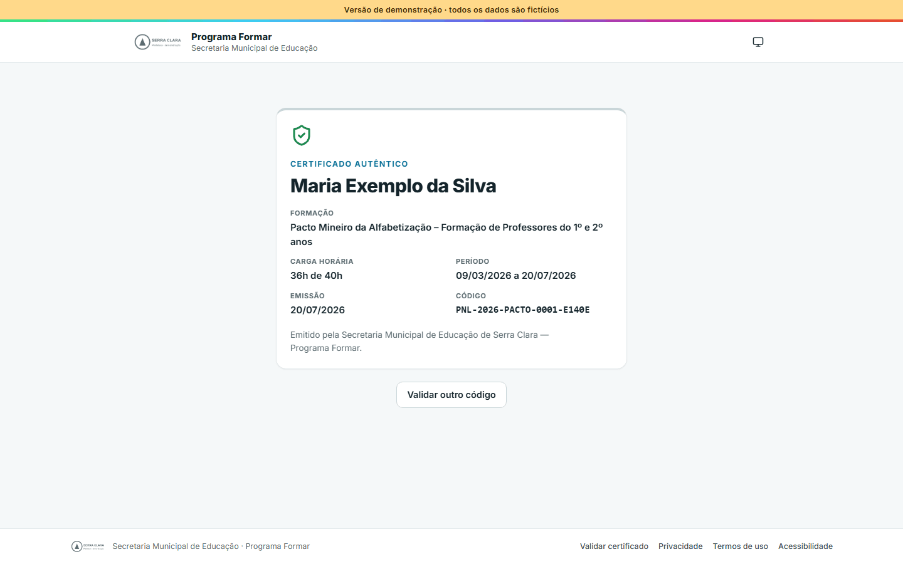<br><sub><b>Validação pública</b>: qualquer pessoa confere a autenticidade pelo código.</sub></td>
    <td>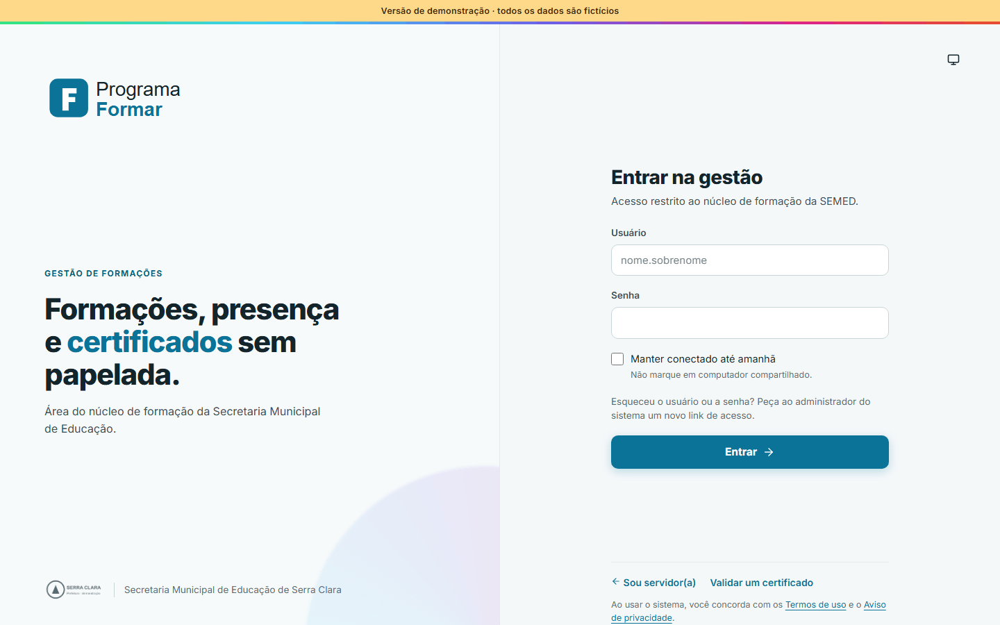<br><sub><b>Acesso</b>: usuário, senha e verificação em duas etapas obrigatória.</sub></td>
  </tr>
</table>

<table>
  <tr>
    <td width="68%">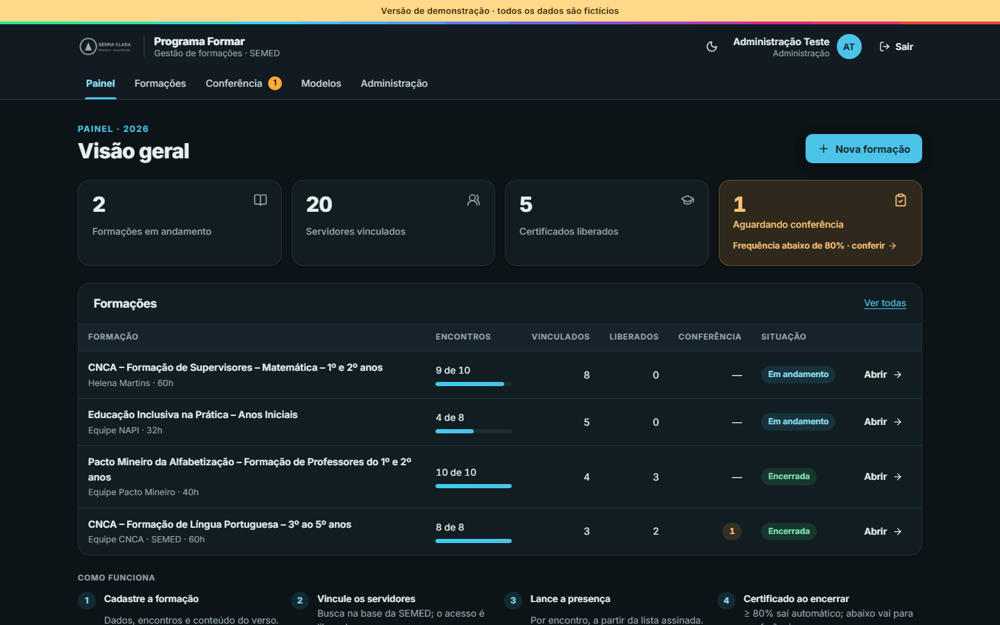<br><sub><b>Tema escuro</b>, claro ou automático, com contraste acessível.</sub></td>
    <td width="32%"><br><sub><b>Celular</b>: todas as telas se adaptam a 375 px.</sub></td>
  </tr>
</table>

## Funcionalidades

| Área | O que faz |
| --- | --- |
| **Administração** | Contas da gestão por convite, edição de contas, importação em lote da base de servidores (.xlsx/.csv com prévia), fila de e-mails e auditoria com filtros e exportação. |
| **Gestão** | Formações e encontros, vínculo de servidores, lançamento de presença, conferência dos certificados abaixo da frequência mínima e modelos de certificado. |
| **Portal do servidor** | Primeiro acesso por CPF e código no e-mail, login com usuário, senha e aplicativo autenticador, acompanhamento da frequência e download dos certificados em PDF. |
| **Validação pública** | Qualquer pessoa confere a autenticidade de um certificado pelo código impresso no verso. |

## Tecnologias

- **Next.js 16** (App Router), **React 19** e **TypeScript**, com renderização no servidor e Server Actions.
- **PostgreSQL** com **Drizzle ORM**; em desenvolvimento, PostgreSQL embutido (**PGlite**), sem Docker.
- **pdf-lib** para os certificados e listas de presença (A4, frente e verso, fonte embutida).
- **Amazon SES** para e-mails transacionais (HTML e texto), com fila e novas tentativas.
- **Vitest** para testes unitários e **ESLint** + **Prettier** para padronização.
- CSS próprio com variáveis (temas claro, escuro e automático), sem framework de UI.

## Executando localmente

Requisitos: Node.js 22 ou mais novo.

```bash
npm install
npm run setup      # cria o .env.local com chaves aleatórias
npm run db:reset   # cria o banco local e carrega os dados fictícios
npm run dev        # http://localhost:3000
```

As contas de teste estão no início de [`scripts/seed.ts`](scripts/seed.ts); a gestão entra com usuário (`admin.teste`, `ana.formadora`), não com e-mail, e exige verificação em duas etapas: no primeiro acesso, leia o QR code com um aplicativo autenticador. Em desenvolvimento, os e-mails não são enviados e aparecem em `/dev/emails`.

> O PGlite aceita um processo por vez: pare o `npm run dev` antes de rodar `npm run db:reset`.

### Conta de administrador

O administrador nunca é criado pela interface:

```bash
npm run admin -- --nome "Nome Completo" --email pessoa@exemplo.org
npm run admin -- --email pessoa@exemplo.org --recuperar   # nova senha e nova verificação em duas etapas
```

O comando imprime um link de uso único, válido por 2 horas, para definir a senha.

## Comandos

| Comando | O que faz |
| --- | --- |
| `npm run dev` | servidor de desenvolvimento |
| `npm run build` / `npm start` | build e servidor de produção |
| `npm run check` | tipos (TypeScript), lint (ESLint) e testes (Vitest) |
| `npm run db:generate` | gera uma migração a partir de `src/db/schema.ts` |
| `npm run db:reset` | recria o banco local com os dados fictícios |
| `npm run db:migrate` / `npm run db:verificar` | aplica as migrações e confere a blindagem do banco de produção |
| `npm run fontes` | regenera as fontes TTF usadas nos PDFs |

## Arquitetura

```
src/
  app/(acesso)/     entrar, primeiro acesso, esqueci a senha ou o usuário
  app/gestao/       painel, formações, conferência, modelos e administração
  app/portal/       formações e certificados do servidor
  app/(publico)/    validação, privacidade, termos e acessibilidade
  components/       cabeçalho, formulários, avisos, prévia do certificado
  lib/auth/         sessões, senhas, duas etapas, limite de tentativas
  lib/acoes/        Server Actions
  lib/dominio/      regras de negócio e serviço transacional
  lib/pdf/          certificado e lista de presença
  db/               esquema e conexão
  proxy.ts          CSP com nonce e bloqueio de rotas sem sessão
drizzle/            migrações versionadas
scripts/            seed, administração, migração e publicação
tests/              testes unitários
```

- As **regras de negócio** são funções puras e testadas em [`src/lib/dominio/regras.ts`](src/lib/dominio/regras.ts); as operações com banco, transações e a máquina de estados dos certificados ficam em [`src/lib/dominio/servico.ts`](src/lib/dominio/servico.ts).
- Toda página, Server Action e rota de PDF confere a sessão no servidor (`exigirGestor`, `exigirAdmin`, `exigirServidor`).

## Segurança e privacidade

Resumo (detalhes em [docs/seguranca.md](docs/seguranca.md)):

- CPF cifrado com AES-256-GCM e buscável apenas por HMAC; as telas mostram só `***.456.789-**`.
- Senhas com Argon2id; sessões em cookie `__Host-`, `HttpOnly`, `SameSite`, com token guardado só como hash.
- Verificação em duas etapas (TOTP) com códigos de recuperação, bloqueio progressivo de tentativas e resposta com tempo constante.
- CSP com nonce, sem `unsafe-inline` para scripts e sem recursos de terceiros.
- Auditoria só de inclusão: o banco recusa alteração e exclusão.

Implantação de referência em [docs/implantacao.md](docs/implantacao.md).

## Aviso

Código publicado somente para demonstração e avaliação. Todos os direitos reservados. Não há autorização para uso em produção, redistribuição ou uso comercial sem permissão do autor.
